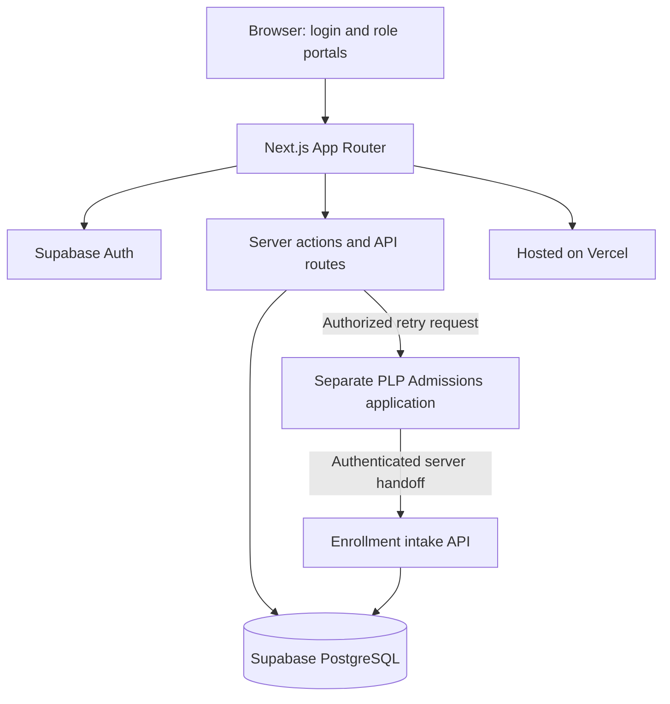
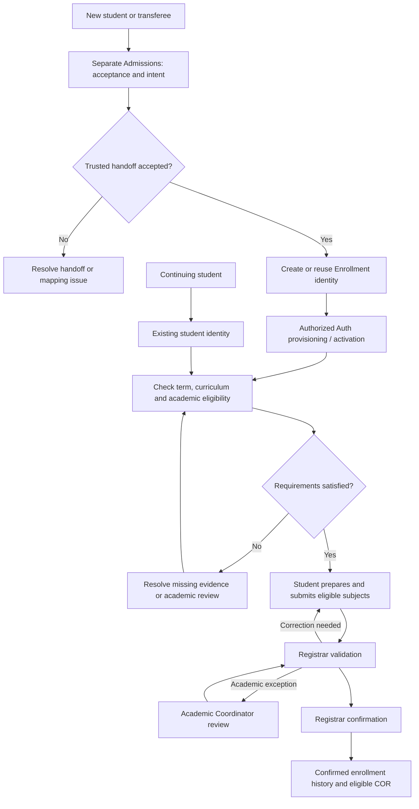

<div align="center">


# PLP Enrollment System

**Pamantasan ng Lungsod ng Pasig (PLP)**

An academic enrollment management application connecting student records, curriculum eligibility, class schedules, registration requests, and authorized staff decisions.

[**Open the deployed application**](https://plp-enrollment-system.vercel.app) · [**Browse the source**](https://github.com/zerxenberg/plp-enrollment-system) · [**Report an issue**](https://github.com/zerxenberg/plp-enrollment-system/issues)


</div>

> [!IMPORTANT]
> **Academic software development project.** This repository is a classroom demonstration developed for PLP. The public Vercel URL is a project deployment, **not evidence that PLP has officially adopted it as a university service**. Some workflows and records are expressly marked **PROJECT_ONLY** or **demonstration**. They must not be treated as actual university enrollment, fees, grades, or certificates.

## Contents

1. [Project overview](#project-overview)
2. [System features](#system-features)
3. [Technology stack](#technology-stack)
4. [Prerequisites and system requirements](#prerequisites-and-system-requirements)
5. [Getting started: downloading the project](#getting-started-downloading-the-project)
6. [Installing dependencies](#installing-dependencies)
7. [Environment variables and Supabase setup](#environment-variables-and-supabase-setup)
8. [Running the application locally](#running-the-application-locally)
9. [User accounts and login credentials](#user-accounts-and-login-credentials)
10. [System user guide](#system-user-guide)
11. [Enrollment workflows](#enrollment-workflows)
12. [Project structure](#project-structure)
13. [Contributing and GitHub workflow](#contributing-and-github-workflow)
14. [Deployment with Vercel](#deployment-with-vercel)
15. [Troubleshooting](#troubleshooting)
16. [Security and data privacy](#security-and-data-privacy)
17. [Documentation and resources](#documentation-and-resources)
18. [Maintainers and license](#maintainers-and-license)

## Project overview

The **PLP Enrollment System** is one Next.js application with four authenticated portals: **Student**, **Registrar**, **Academic Coordinator**, and **System Administrator**. It aims to make enrollment status, available subjects, prerequisites, section planning, and record review easier to understand and manage. Access is scoped by role; seeing a page or control does not grant permission to perform its protected operations.

The project connects academic reference data with enrollment processing. Academic Coordinators manage eligible programs, curricula and sections; students review their allowed registration options; Registrars validate and confirm enrollment; System Administrators manage accounts, technical configuration and integration. Registrar confirmation is separate from the student's submission.

**Admissions is a separate application.** New applicants and transferees complete the Admissions process there. A trusted server integration transfers accepted applicants and creates or links an Enrollment identity. The transfer alone does **not** activate login, establish academic eligibility, assign an official timetable, or confirm enrollment. Continuing students keep their existing identity and do not apply again.

### Roles at a glance

| Role | Primary responsibility | Portal |
| --- | --- | --- |
| **Student** | Review academic records, eligibility, enrollment, timetable, and profile | [Student Portal](https://plp-enrollment-system.vercel.app/student/dashboard) |
| **Registrar** | Review student records and submissions, import grades, and perform authorized enrollment validation and confirmation | [Registrar Portal](https://plp-enrollment-system.vercel.app/registrar/dashboard) |
| **Academic Coordinator** | Maintain curricula, programs, subjects, sections, schedules, and defined academic decisions | [Academic Coordinator Portal](https://plp-enrollment-system.vercel.app/academic-coordinator/dashboard) |
| **System Administrator** | Manage accounts and technical access, inspect integrations and operational activity | [System Administrator Portal](https://plp-enrollment-system.vercel.app/system-administrator/dashboard) |

All role routes require an appropriately authorized account.

### System architecture



**Project preview:** The repository includes the PLP branding assets used by the application. A public gallery of all five portal screenshots is not included because sanitized, approved screenshots have not been committed to this repository. For the current interface, open the [deployed login portal](https://plp-enrollment-system.vercel.app); authenticated pages require a permitted account.

## System features

The tables describe **implemented interface areas and code paths**, including their operational restrictions. Actual results depend on the account's permissions, live Supabase data, configured academic periods, and any required database functions. A visible feature is not necessarily available to every user.

### Student Portal

| Module | Implemented capabilities and restrictions |
| --- | --- |
| **Dashboard** | Student identity, academic or enrollment overview, status and next steps, with context appropriate to the account's data source. |
| **Enrollment** | Current Enrollment and Enrollment History tabs; permitted enrollment preparation or submission, review of subjects/sections and recorded status. The project demonstration track is explicitly identified separately from official enrollment. |
| **Academic Records** | Academic History and Curriculum Progress; verified published results and applicable credited or pending items where available. |
| **Class Schedule** | Verified proposed or registered class meetings, subject and section details, subject to availability and confirmation state. |
| **Notifications** | Student notification interface; delivery and persistence depend on the active provider. |
| **Student Profile** | Student account details and permitted profile/contact or password operations. |
| **Registration documents** | Authorized PDF endpoints for confirmed official COR records and separately labeled project demonstration registration documents. Availability requires a corresponding valid enrollment and record snapshots. |

New students and transferees enter through the separate Admissions handoff. Transferee placement and credited work require an authorized evaluation. Continuing students use their existing account and have current subject eligibility assessed against applicable records, grades, prerequisites, and offered sections. **Irregular classification does not automatically reject enrollment**; an unmet prerequisite can restrict an individual subject.

The student interface exposes different actions for unready, editable, submitted, returned, and confirmed states. Academic evidence or an active enrollment period may be required before a submission can proceed.

### Registrar Portal

| Module | Implemented capabilities and restrictions |
| --- | --- |
| **Dashboard** | Enrollment overview, student counts, queues and capacity indicators relevant to the Registrar. |
| **Students** | Search and inspect student records, details and applicable history; authorized actions are permission checked. |
| **Enrollment** | Review applications, validation and correction flows, confirmation and history; distinct official and project demonstration paths are identified. |
| **Academic & Scheduling** | Read-only curriculum, section, schedule, classroom and capacity reference views. |
| **Reports & Monitoring** | Registrar-oriented enrollment and record reporting views. |
| **Notifications and Profile** | Registrar notification, profile and applicable account settings pages. |
| **Grade import** | Project and institutional CSV/XLSX preview, staging, validation, source verification and publication workflows. The **project grade import history** is available; the **institutional import history view is currently unavailable**. |

Grade import **does not mean uploaded grades are automatically official or published**. Validation, evidence and protected approval or correction requirements may block publication. Registrar authority covers official confirmation, not curriculum design or technical administration.

### Academic Coordinator Portal

| Module | Implemented capabilities and restrictions |
| --- | --- |
| **Dashboard** | Academic planning and section information with relevant review indicators. |
| **Academic Setup** | Program, shared subject and curriculum version views and authorized management operations; prerequisites and semester/year structure. Protected synthetic demonstration curricula are read-only. |
| **Sections & Schedules** | Block sections, capacities, proposed assignments, subject classes, rooms, instructors and weekly meeting planning. Includes a scoped Admissions demonstration roster for eligible linked applicants. |
| **Academic Review** | Review of defined enrollment academic exceptions and protected project grade correction decisions. |
| **Reports & Monitoring** | Academic reports, capacity/scheduling summaries and change history views. |

Planning a section or proposing a student assignment **does not create official term enrollment**. Academic Coordinators decide academic matters within their authority; they do not issue the Registrar's final confirmation. Demonstration curricula, fee estimates and Admissions simulation assignments retain their noninstitutional labels.

The default **Live Academic Planning** workspace saves supported work in Supabase, but currently scopes its source data to the **PROJECT_ONLY demonstration cohort**. Here, “live” means database-backed rather than authoritative institutional curriculum records. The separate synthetic preview is read-only.

### System Administrator Portal

| Module | Implemented capabilities and restrictions |
| --- | --- |
| **Dashboard** | Technical and access-related summary information. |
| **Users & Access** | Application account lookup, linked Auth account provisioning, activation/access actions and controlled roles or permissions where available. |
| **System Integration** | Admissions handoff status, imported records, health indicators, guarded retry synchronization and pending invitation reconciliation where configured. |
| **System Administration** | Protected system/security settings, maintenance actions, backup metadata and supported application data export. An application export is **not** a full PostgreSQL/Auth backup or a tested disaster recovery procedure. |
| **Audit & Monitoring** | Security or integration activity, audit events, errors and technical monitoring information available to the authorized administrator. |
| **Notifications and Profile** | Dedicated routes accessible through the portal header/sidebar profile actions. |

Some system administration surfaces are **informational or restricted**, rather than a promise of automatic backups, full disaster recovery, or unrestricted database editing. System Administrators do not approve academic exceptions or confirm official enrollments.

### Official records and demonstration records

| Track | Meaning |
| --- | --- |
| **Institutional enrollment** | Protected enrollment records and Registrar confirmation, when a valid term, student and academic data exist. Official COR generation is guarded by record and authorization checks. |
| **PROJECT_ONLY / Phase 8** | Fictional student data and published demonstration curricula, subjects, schedules, grade imports, registration and fee examples. Some Admissions identities can participate in a **separate** simulation ledger. A confirmed simulation is **not** official registration. |
| **External Admissions** | An accepted and transferred applicant identity is a handoff record, not an automatic eligibility or enrollment decision. |

See [Admissions integration documentation](docs/integration/admissions-intake.md) and [the demonstration workflow](docs/integration/admissions-phase8-demonstration-workflow.md) for the exact separation.

## Technology stack

| Layer | Verified implementation |
| --- | --- |
| Frontend | **Next.js 16.4.2** App Router, **React 19.3.0**, JavaScript, CSS |
| Server | Next.js server actions and route handlers under `src/app/api` |
| Authentication | Supabase Auth with application role/account checks |
| Database | Supabase managed **PostgreSQL**, trusted functions and scoped Row Level Security policies |
| Supabase clients | `@supabase/supabase-js` and `@supabase/ssr` |
| Files and documents | `papaparse`, `read-excel-file`, `xlsx`, `pdfkit`, `fflate` |
| Interface icons | `lucide-react` through the shared icon registry |
| Hosting | Vercel |
| Collaboration | Git, GitHub, GitHub Actions |
| Development | Node.js, npm, Visual Studio Code or another editor |
| Validation | ESLint, Node's built-in test runner, selected Playwright tooling |

Dependency versions are recorded in [`package.json`](package.json) and resolved in [`package-lock.json`](package-lock.json). This application is **JavaScript**, not a TypeScript or Tailwind CSS project.

## Prerequisites and system requirements

| Tool | Why you need it | Version and installation |
| --- | --- | --- |
| **Node.js** | Runs the Next.js server and provides npm | **20.9.0 or newer** is required by the installed Next.js 16.4.2 package. Use a maintained compatible LTS version from [nodejs.org](https://nodejs.org/en/download). |
| **npm** | Installs dependencies and runs scripts | Included with Node.js; use a version bundled with a compatible Node release. |
| **Git** | Clones and updates the repository | [git-scm.com/downloads](https://git-scm.com/downloads); no repository-specific minimum version declared. |
| **Code editor** | Opens and edits source files | [Visual Studio Code](https://code.visualstudio.com/download) recommended; optional. |
| **Web browser** | Opens the local and deployed application | A current Chrome, Edge, Firefox or Safari release. |
| **Supabase access** | Provides configured authentication, schema, functions, RLS and project data | An **authorized, provisioned** project from [supabase.com](https://supabase.com). A free new project alone is not a ready PLP database. |

**Windows 10/11:** Download and run the official Node.js LTS installer, then the Git for Windows installer. Close and reopen Command Prompt after installation. Install VS Code if you would like to use the `code .` command (choose the installer option to add VS Code to PATH, or open the folder from VS Code).

**macOS/Linux:** Use your platform's official Node.js installation instructions or a compatible Node version manager; install Git using your OS package manager or the official downloads.

Confirm the tools are available in a **new** terminal:

```cmd
node -v
npm -v
git --version
```

Each command should print a version, such as `v22.x.x`, an npm version and `git version ...`. The exact patch versions may differ. If a command is not recognized, verify the installation and your terminal's PATH.

## Getting started: downloading the project

**Repository:** [github.com/zerxenberg/plp-enrollment-system](https://github.com/zerxenberg/plp-enrollment-system)

### Method 1: Clone with Git (recommended)

1. Open the repository above, select **Code**, and copy its **HTTPS** URL.
2. Open **Command Prompt (cmd)** on Windows.
3. Change to your Desktop (or your preferred working folder), then clone:

   ```cmd
   cd %USERPROFILE%\Desktop
   git clone https://github.com/zerxenberg/plp-enrollment-system.git
   cd plp-enrollment-system
   code .
   ```

4. If `code .` is not recognized, open VS Code and choose **File → Open Folder**. Select the cloned `plp-enrollment-system` folder.

On **macOS/Linux**, use a terminal:

```bash
cd ~/Desktop
git clone https://github.com/zerxenberg/plp-enrollment-system.git
cd plp-enrollment-system
code .
```

If the repository is private, GitHub may require an authenticated account with access. Git cloning preserves version history and supports future `git pull` operations.

### Method 2: Download ZIP

1. Open the repository page on GitHub.
2. Select **Code → Download ZIP**.
3. Extract the archive to a convenient folder.
4. In VS Code, select **File → Open Folder** and open the extracted folder.

The ZIP contains a snapshot without Git history. Clone with Git if you plan to synchronize work or contribute.

## Installing dependencies

1. Open the project in VS Code, then select **Terminal → New Terminal** (or use Command Prompt in the project folder).
2. Verify that the terminal is inside `plp-enrollment-system`, where `package.json` is located.
3. Install exactly the versions resolved by the committed npm lockfile:

   ```bash
   npm ci
   ```

4. Let npm finish. It creates the local `node_modules` directory, which is ignored by Git.

`npm ci` is preferred for a fresh clone because it uses the existing `package-lock.json` and avoids rewriting it. `npm install` can be used when intentionally changing dependencies, but it may update the lockfile. If installation fails, verify your Node version, internet connection, and npm error message before changing package versions.

## Environment variables and Supabase setup

Environment variables supply settings without hardcoding them in source control. Variables beginning with `NEXT_PUBLIC_` are bundled for browser access; **never place a secret in a public variable**. All integration credentials and privileged Supabase keys are **server only**.

### 1. Create the environment file

The repository provides [`.env.example`](.env.example), a sanitized template with no active credentials.

**Windows Command Prompt:**

```cmd
copy .env.example .env.local
```

**PowerShell:**

```powershell
Copy-Item .env.example .env.local
```

**macOS/Linux:**

```bash
cp .env.example .env.local
```

Open `.env.local` in your editor. Obtain the actual permitted values from the project maintainers or the appropriate service dashboards. Leave optional integrations off until configured. The `.gitignore` excludes local environment files.

### 2. Configure the correct Supabase project

1. Request access to the **existing intended Enrollment Supabase project** from its owner. Creating a new Supabase project does not install PLP data or database functions.
2. In the Supabase dashboard, find the **Project URL** and **publishable key** under **Project Settings / API** or the project's **Connect** information, depending on the dashboard version.
3. Set `NEXT_PUBLIC_SUPABASE_URL` and `NEXT_PUBLIC_SUPABASE_PUBLISHABLE_KEY` in `.env.local`.
4. Ask the authorized owner to supply a **server-only Enrollment project secret key** securely for `SUPABASE_SECRET_KEY` if your assignment requires privileged server actions. The legacy `SUPABASE_SERVICE_ROLE_KEY` is supported as a fallback. **Never commit or send either key in a public issue.**
5. Obtain `AUTH_IDENTIFIER_HASH_SECRET` (a server-only secret of at least 32 characters) from the maintainer for the protected University ID identifier workflow.
6. Confirm the destination Supabase environment already has the appropriate schema, protected functions, users, current table grants and RLS policies for the features you plan to test.

The browser uses the public Supabase configuration for authenticated sessions. The server handles privileged operations through separate trusted code. **Auth users, application users and student profiles must be correctly linked**; creating an arbitrary Supabase Auth user is insufficient to enter a portal.

The [`supabase/migrations/`](supabase/migrations) directory contains historical and reviewed SQL, and [`supabase/seed/`](supabase/seed) contains project-specific resources. **There is no verified, self-contained, one-command fresh database installation procedure for a new contributor.** Do not apply historical migrations or seed data to an existing database without the database owner's reviewed deployment process. Existing live data repairs follow controlled, authorized direct SQL procedures.

### 3. Configuration reference

| Variable | Exposure | Purpose | When needed |
| --- | --- | --- | --- |
| `NEXT_PUBLIC_SUPABASE_URL` | Public | Enrollment Supabase project URL | **Required** for the app's Supabase clients |
| `NEXT_PUBLIC_SUPABASE_PUBLISHABLE_KEY` | Public | Supabase browser/public Auth API key | **Required** for the app's Supabase clients |
| `SUPABASE_SECRET_KEY` | **Server only** | Privileged Enrollment Supabase client | **Required for protected backend/admin actions**; preferred option |
| `SUPABASE_SERVICE_ROLE_KEY` | **Server only** | Legacy alternative to `SUPABASE_SECRET_KEY` | Only if using legacy key instead |
| `AUTH_IDENTIFIER_HASH_SECRET` | **Server only** | Protects the University ID identifier lookup | Required for protected ID-login configuration |
| `ENROLLMENT_INTAKE_SECRET` | **Server only** | Authenticates Admissions intake/program reference and retry requests | When using Admissions handoff or retry integration |
| `ADMISSIONS_RETRY_SYNC_URL` | **Server only** | HTTPS endpoint on the **separate Admissions server** for manual retry | Required for production **Retry Sync from Admissions** |
| `ADMISSIONS_AUTO_PROVISION_ENABLED` | **Server only** | Enables optional real Supabase Auth invitation emails; defaults to `false` | Only after explicitly configuring and approving invitations |
| `ADMISSIONS_INVITE_REDIRECT_URL` | **Server only** | Approved invitation callback ending in `/activate-student-account` | When enabling invitations; production must use HTTPS |
| `NEXT_PUBLIC_ADMISSION_SYSTEM_URL` | Public | Destination of **Apply for Admission** link | Optional; otherwise the app uses its local `/admission` information route |
| `PLP_ADMISSIONS_HEALTH_URL` | **Server only** | Optional upstream Admissions URL whose **configuration presence** is reported | Optional status metadata; the current status reader does not actively probe this URL |
| `NEXT_PUBLIC_APP_NAME` | Public | Application name field in the example template | Optional template metadata; not required for core startup |

For production, give privileged settings to the hosting platform as **server environment variables**. The public Supabase key is designed for use in a browser but does **not** replace RLS, role checks, or server validation.

### 4. Admissions integration and separate environments

The Enrollment application exposes protected Admissions routes, including:

| Endpoint | Responsibility |
| --- | --- |
| `POST /api/integration/admissions/intake` | Receive a signed trusted handoff from Admissions |
| `GET /api/integration/admissions/programs` | Provide authorized program mapping to Admissions |
| `GET /api/integration/admissions/status` | Authorized synchronization status information |
| `GET /api/integration/admissions/health` | Limited public integration route health indicator; **not** a database readiness guarantee |

The **System Administrator → System Integration → Retry Sync from Admissions** server action calls the URL in `ADMISSIONS_RETRY_SYNC_URL` using the shared `ENROLLMENT_INTAKE_SECRET`. Production requires an HTTPS Admissions endpoint capable of handling that request. The current development code has a localhost-only default for the retry endpoint; it does **not** use that fallback in production.

The **Admissions server** separately needs its outbound intake URL, matching shared secret, and its own Supabase settings. It must call the Enrollment intake endpoint. Do not exchange the two projects' privileged Supabase keys.

**Important:** An integration that works on localhost may fail on Vercel because `.env.local` is not uploaded by Git, the production URL is missing, the secret differs, the Admissions endpoint is unavailable, or the target database has not been prepared. Set matching **Production** variables in the appropriate Vercel projects, deploy the relevant configuration changes, and use the System Integration status and server logs to diagnose failures **without printing secrets**.

Optional invitations are **off by default**. Enabling them requires configured Supabase Auth invitation templates, allowed redirect URLs, working email delivery and administrator approval. Historical accepted handoffs can be reconciled through the authorized invitation action when enabled; email verification and account activation still have separate checks.

Further details: [Trusted intake contract](docs/integration/admissions-intake.md) · [REST retry contract](docs/integration/admissions-retry-sync-rest.md).

## Running the application locally

1. Open a terminal in the project folder.
2. Complete `npm ci` and the required `.env.local` configuration.
3. Start the Next.js development server:

   ```bash
   npm run dev
   ```

4. Open the **Local** address printed by Next.js, normally [http://localhost:3000](http://localhost:3000). If port 3000 is already in use, Next.js may select another port; use the address shown in the terminal.
5. Log in with an approved linked account. Database-backed functionality will not operate correctly without the intended configured Supabase environment.
6. To stop the server, press **Ctrl+C** in its terminal.

After changing `.env.local`, stop and restart the development server so it receives the updated variables.

### Available npm scripts

| Command | Meaning |
| --- | --- |
| `npm run dev` | Run Next.js in development mode with fast local refresh |
| `npm run lint` | Run the project's ESLint configuration |
| `npm run build` | Create and validate a production build |
| `npm run start` | Serve a **previously built** production version locally |

For a local production-mode check:

```bash
npm run build
npm run start
```

Development mode rebuilds as you edit. Production mode requires a successful build and more closely matches deployment. Running the app locally does **not** automatically set up Supabase or confer account permissions.

## User accounts and login credentials

| User role | Purpose | Access method |
| --- | --- | --- |
| Student | Review own enrollment and academic data | Approved linked student account |
| Registrar | Official enrollment processing and student records | Assigned Registrar staff account |
| Academic Coordinator | Academic planning and exception decisions | Assigned Academic Coordinator staff account |
| System Administrator | User access and technical administration | Assigned System Administrator account |

### Sign in

1. Open the [login portal](https://plp-enrollment-system.vercel.app).
2. In **University ID Number or Registered Email**, enter your approved identifier.
3. Enter the password and select **Login**.
4. After successful authentication and account validation, the system routes you to your role's portal. Some eligible project accounts must change their initial password before normal use.
5. To sign out, use the **Logout** action in the portal sidebar.

The form supports authorized University ID lookup as well as registered email sign-in through Supabase Auth. A valid password alone does not guarantee access. The related application account must be linked, **Active**, permitted to log in, and recognized as an authorized role. An Admissions applicant may need to complete an invitation, email verification and activation process first.

**New applicants or transferees:** choose **Apply for Admission** on the login page. The full application is handled by the separate Admissions system. **Continuing students:** use the existing account; do not create a new applicant identity.

### Getting credentials and resetting access

Cloning the project does **not** provide a student, staff, or administrator account. An authorized System Administrator and the project maintainers control account provisioning, linkage, activation, and approved evaluation access. The login form's **Forgot Password?** link directs users to contact the System Administrator. Existing permitted account/profile workflows also provide password changes where authorized.

**Demo account credentials are provided only to authorized evaluators or project contributors. Contact the project maintainers to request access.** No public passwords, temporary credentials or real student identifiers are distributed in this README.

## System user guide

These instructions describe the available portal flow **when the account and current records support it**. A disabled button or missing record is not permission to bypass the server's checks.

### Student

1. **Log in**, then open **Dashboard** to review your identity, current condition and next action.
2. Open **Academic Records** to view **Academic History** and **Curriculum Progress**, including available published grades or approved credits.
3. Open **Enrollment → Current Enrollment** to inspect eligibility, subjects, section availability and your current registration status.
4. If the account and academic period allow it, prepare or submit the available enrollment form. Resolve any recorded missing requirement or returned correction before resubmitting.
5. Check **Enrollment History** and **Class Schedule** for saved transactions and verified class meeting details.
6. When the corresponding record is **confirmed and complete**, access its applicable Certificate of Registration or clearly marked **demonstration registration PDF**.
7. Use **Notifications** and **Student Profile** for available messages and permitted account details. Sign out through the sidebar.

**Submitting does not confirm enrollment.** A Registrar must perform the required official validation and confirmation. Project-only confirmations remain simulations.

### Registrar

1. Open **Dashboard** for enrollment workload and capacity indicators.
2. Search **Students** and inspect a student's permitted records or history.
3. In **Enrollment**, review the relevant official or demonstration queue, inspect a submission, validate or return it with a reason where the workflow allows, and confirm only an eligible validated transaction.
4. Review **Enrollment History** to trace actions and confirmed registrations.
5. Open **Students → Grade Import** to stage supported CSV/XLSX source files, inspect validation findings, and complete the required review or publication steps if authorized. Resolve project conflicts through the protected academic review route. Project import history is available; institutional import history is not yet exposed.
6. Use **Academic & Scheduling** as a **read-only** curriculum and section reference. Check **Reports & Monitoring** and **Notifications** as needed.

### Academic Coordinator

1. Open **Dashboard** to inspect academic planning indicators.
2. Use **Academic Setup** for supported program, subject, prerequisite and curriculum version management. Protected demo sources may be read-only.
3. Use **Sections & Schedules** to inspect block capacity, plan section/subject meetings, and manage allowed assignments. Verify whether an operation applies to an official source or a separate Admissions demonstration.
4. Open **Academic Review** to decide authorized academic exceptions or project grade conflict cases according to the available evidence and roles.
5. Check **Reports & Monitoring** for reports and recorded academic changes.

Academic planning and proposed assignments do **not** replace an official Registrar confirmation.

### System Administrator

1. Open **Dashboard** and **Users & Access** for available account and access information.
2. Provision or link approved Supabase Auth accounts to existing application users; apply permitted activation, permissions and password administration actions.
3. Open **System Integration** to inspect accepted handoffs, status and health information. Use **Retry Sync from Admissions** only with its matching protected server configuration. Review pending invitations if enabled.
4. Use **System Administration** for actually exposed technical settings and **Audit & Monitoring** for available logs, activity and errors.
5. Escalate academic and official enrollment decisions to the Academic Coordinator or Registrar respectively.

## Enrollment workflows

### Applicant and continuing student paths



**Freshman:** Admissions completion and trusted handoff precede the Enrollment account and term checks. **Transferee:** additionally requires any applicable authorized transfer evaluation and year-level placement. **Continuing student:** retains one account; subject-by-subject prerequisite and academic progression checks determine permitted choices. A missing prerequisite normally blocks the dependent subject, not every subject.

The supported canonical institutional enrollment status vocabulary includes `NOT_ELIGIBLE`, `ELIGIBLE`, `IN_PROGRESS`, `SUBMITTED`, `FOR_VALIDATION`, `NEEDS_ACADEMIC_REVIEW`, `REQUIRES_CORRECTION`, `VALIDATED`, `CONFIRMED` and `CANCELLED`. Availability and permitted transitions depend on the current implementation and database rules. **`CONFIRMED` is the official confirmation state**. The separate demonstration path can use values such as `CONFIRMED_SIMULATION` and must remain clearly nonofficial.

## Project structure

Simplified view of the **actual repository**. Parentheses are Next.js route groups and do not appear in public URLs.

```text
plp-enrollment-system/
├── .agents/skills/            # Project-specific coding guidance
├── .github/workflows/         # GitHub Actions checks
├── docs/                      # Integration and implementation notes
├── public/assets/images/      # PLP branding and other static assets
├── scripts/                   # Project-specific support scripts
├── src/
│   ├── app/
│   │   ├── (auth)/            # Login and admission entry pages
│   │   ├── (portal)/          # Student, Registrar, Coordinator, Administrator pages
│   │   └── api/               # Auth, integration, COR and related endpoints
│   ├── components/            # Role, UI, auth, layout and COR components
│   ├── config/                # Portal navigation configuration
│   ├── constants/             # Shared domain constants
│   ├── data/                  # Mock and supporting data resources
│   ├── features/              # Auth, admissions, academic, enrollment and reports logic
│   ├── lib/                   # Supabase, authentication and validation helpers
│   ├── styles/                # Shared portal styles
│   └── utils/                 # Shared utilities
├── supabase/
│   ├── migrations/            # Reviewed historical schema change resources
│   └── seed/                  # Project-specific setup/test material
├── tests/                     # Selected automated tests
├── .env.example               # Safe environment variable names/defaults
├── .gitignore                 # Excluded local data and secrets
├── next.config.mjs            # Next.js configuration
├── package.json               # npm scripts and dependencies
├── package-lock.json          # Resolved dependency versions
├── proxy.js                   # Supabase session refresh integration
└── README.md
```

Generated `.next` files, `node_modules`, local secrets and build caches are not committed. Additional documentation and data migration artifacts may exist for the classroom project; review their provenance and intended environment before use.

## Contributing and GitHub workflow

Use a current, authorized checkout of the repository. The tracked production work branch is **`main`**. The repository contains a [GitHub Actions enrollment check workflow](.github/workflows/student-enrollment-checks.yml) for pushes and pull requests; **do not assume branch protection or required-review rules exist unless GitHub confirms them**.

Suggested contributor sequence:

1. Inspect your branch and uncommitted work:

   ```bash
   git branch --show-current
   git status
   ```

2. On a **clean** local `main`, synchronize with the remote:

   ```bash
   git switch main
   git pull --ff-only origin main
   ```

3. Create a feature/documentation branch:

   ```bash
   git switch -c docs/improve-setup-guide
   ```

4. Make a scoped change, inspect it, and verify as applicable:

   ```bash
   git diff
   npm run lint
   npm run build
   ```

5. Stage **only** intended files and commit:

   ```bash
   git add README.md
   git commit -m "docs: clarify local development setup"
   git push -u origin docs/improve-setup-guide
   ```

6. Open a **pull request** from your branch to `main` on GitHub when contributor permissions and repository policy allow. Get the appropriate review before merging.

Use clear [Conventional Commits](https://www.conventionalcommits.org/en/v1.0.0/) such as `feat: add student eligibility view`, `fix: correct schedule validation` or `docs: update environment guide`. Before pulling or switching branches, preserve teammates' and your own pending changes. Resolve conflicts deliberately; **do not force push, reset others' work, or add `.env.local`**.

## Deployment with Vercel

The application is deployed at **[plp-enrollment-system.vercel.app](https://plp-enrollment-system.vercel.app)**. Access to its Vercel project and GitHub repository is controlled by the respective owners.

1. In [Vercel](https://vercel.com/docs), an authorized maintainer links/imports the GitHub repository and selects the intended production branch (currently the repository's `main` workflow).
2. Use the detected Next.js framework and the repository's `npm run build` script. Dependencies are resolved from the npm project files.
3. In **Vercel Project → Settings → Environment Variables**, configure values for the intended **Production** and, if used, **Preview** environments. Set Supabase and Admissions server secrets there securely. Use the correct external service endpoints for each environment.
4. Review **Deployments** and the **Build Logs** for the selected commit. For runtime issues, inspect the deployment's available server/function logs.
5. Verify the deployment is ready, visit the production URL, and test permitted login and affected workflows with approved accounts. A successful build alone does not prove database readiness or a working Admissions integration.

**A local `.env.local` never travels to Vercel via a GitHub push.** Changes to hosted environment variables require the appropriate Vercel configuration and a deployment using those values. The System Integration warning to configure `ADMISSIONS_RETRY_SYNC_URL` and `ENROLLMENT_INTAKE_SECRET` indicates absent required server configuration for retry synchronization. Verify **variable names and presence** in the Vercel dashboard, rather than copying secret values into logs.

A **README-only Git commit** updates repository documentation. It may trigger Vercel's connected Git deployment workflow, depending on the project settings, but does not itself change application behavior or the database. A new deployment is not required solely for local Markdown rendering.

## Troubleshooting

| Problem | Possible cause | Recommended solution |
| --- | --- | --- |
| `node` or `npm` is not recognized | Node.js missing or PATH not updated | Install a compatible Node.js version and reopen the terminal; verify `node -v` and `npm -v`. |
| `git` is not recognized | Git missing or PATH not updated | Install Git for your OS, reopen the terminal and run `git --version`. |
| `npm ci` fails | Node version mismatch, network error or lockfile mismatch | Check the displayed error and Node version; use the committed lockfile, then seek review before changing dependencies. |
| `next` cannot be found / `node_modules` missing | Dependencies were not installed | Run `npm ci` in the project root. |
| Blank/error page or missing Supabase configuration | Missing/incorrect public URL or publishable key | Set the correct Enrollment project values in `.env.local` and restart Next.js. |
| Supabase connection error | Wrong project URL/key, network or project unavailable | Verify the intended project and access with its owner; check server logs without disclosing keys. |
| Login fails | Wrong credentials, unlinked Auth account, missing verification or required server service | Use approved credentials; ask an authorized admin to check account link, activation and service availability. |
| Account inactive / not allowed to log in | `account_status` or `login_enabled` guard | Contact the System Administrator; do not bypass the check. |
| Unexpected portal or unauthorized action | Role or backend permission mismatch | Verify the assigned application role and authorized privileges with the administrator. |
| Permission or RLS error | Missing approved policy, grant or wrong user ownership | Have the database owner inspect scoped RLS and function permissions. **Never disable RLS as a workaround.** |
| Student data or class schedule missing | No linked student, published academic evidence, offered section, or prepared term | Inspect the current account, term, data source and applicable academic/Registrar workflow. |
| Grade import cannot publish | Invalid source, unresolved conflicts, missing accepted evidence, or restricted permission | Review the import findings and follow the guarded Registrar/Coordinator correction workflow. |
| Admissions handoff fails | Secret mismatch, unavailable intake, invalid applicant/program mapping, or missing trusted database function | Check protected integration logs and the [intake contract](docs/integration/admissions-intake.md); reconcile source data with its owner. |
| **Retry Sync from Admissions** asks for configuration on Vercel | Missing production `ADMISSIONS_RETRY_SYNC_URL` or `ENROLLMENT_INTAKE_SECRET` | Set both server-only variables in the **Enrollment Vercel project**, confirm the Admissions retry endpoint and matching shared secret, then verify a deployment using those settings. |
| Local retry works but Vercel retry fails | Localhost default or local environment variables are not available in production | Configure the production HTTPS Admissions endpoint and server secrets in Vercel; inspect server response/logs. |
| Port 3000 is busy | Another local service uses that port | Open the alternate Local URL printed by Next.js, or stop the conflicting local service. |
| `npm run build` fails | Code/configuration or build-time environment error | Read the first meaningful build error, verify supported Node version and project settings; do not edit unrelated code blindly. |
| Vercel deployment fails | Build error, Git integration issue or missing environment variables | Check the specific deployment's Build Logs, connected branch and environment assignments. |
| Local source is outdated | Wrong branch or local main behind origin | Run `git status` and `git branch --show-current`; safely synchronize clean `main` with `git pull --ff-only origin main`. |

## Security and data privacy

The application uses Supabase Auth, application roles and active-account checks, server-authorized actions, and scoped database policies/functions. Student and academic information must be available only to authorized identities. Protected enrollment confirmations, grade operations, provisioning and integration actions require applicable backend verification and audit behavior.

**Keep privileged keys, tokens, passwords, student identity data, and private environment files out of Git and screenshots.** Do not expose `SUPABASE_SECRET_KEY`, `SUPABASE_SERVICE_ROLE_KEY`, `ENROLLMENT_INTAKE_SECRET`, database credentials, or auth/session tokens. Never turn off RLS or bypass permissions to make a demo work.

This repository includes fictional academic demonstration datasets. They are examples for development and evaluation, not independently verified university student or faculty records. If sharing screenshots, use approved synthetic accounts, redact identifying fields, and confirm the captured page has no private operational details.

See [project authentication deployment scope](docs/database-normalization/project-auth-deployment/PROJECT_SCOPE_POLICY_CURRENT.md) for documented classroom-specific security decisions.

## Documentation and resources

### Project documentation

| Resource | Covers |
| --- | --- |
| [Trusted Admissions intake](docs/integration/admissions-intake.md) | External handoff, identity mapping, provisioning and permissions |
| [Admissions retry synchronization](docs/integration/admissions-retry-sync-rest.md) | Retry endpoint contract and environment requirements |
| [Admissions demonstration workflow](docs/integration/admissions-phase8-demonstration-workflow.md) | Distinguishing Admissions project registration from official records |
| [Registrar project enrollment report](docs/database-normalization/project-auth-deployment/PHASE8_REGISTRAR_ENROLLMENT_IMPLEMENTATION_REPORT_20261026.md) | Phase 8 implementation notes and historical verification limitations |
| [Student portal enrollment recovery](docs/database-normalization/project-auth-deployment/STUDENT_PORTAL_ENROLLMENT_RECOVERY_20261027.md) | Student eligibility and registration work |
| [Project security scope](docs/database-normalization/project-auth-deployment/PROJECT_SCOPE_POLICY_CURRENT.md) | Current classroom project access decisions |
| [Grade import tests](tests/grade-import/README.md) | Grade import test data and verification context |
| [Repository coding policy](AGENTS.md) | Role boundaries, source conventions and protection rules |

Some documents are **dated implementation reports**. Consult the current source code and deployment state before treating past test results or database observations as current.

### Official technology references

[Next.js documentation](https://nextjs.org/docs) · [Node.js](https://nodejs.org/en/learn) · [Supabase documentation](https://supabase.com/docs) · [PostgreSQL documentation](https://www.postgresql.org/docs/) · [Git documentation](https://git-scm.com/doc) · [GitHub documentation](https://docs.github.com/) · [Vercel documentation](https://vercel.com/docs)

## Maintainers and license

**Development context:** Academic software development project for Pamantasan ng Lungsod ng Pasig. The repository owner and authorized collaborators maintain this code; individual contributor names and private contact information are intentionally omitted.

For a bug report or contribution proposal, use [GitHub Issues](https://github.com/zerxenberg/plp-enrollment-system/issues) when accessible, or contact the project maintainers through approved course or repository channels. Never attach credentials, identifiable student records or private logs.

**License:** There is **no `LICENSE` file in this repository** at the time of this README update. Public source visibility does not automatically grant permission to reuse, redistribute or publish derivatives. Obtain clarification from the repository owner before relying on any license rights.
