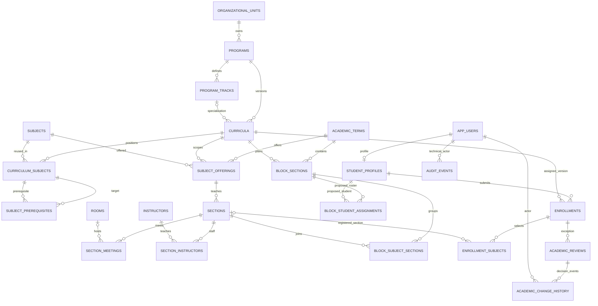

# PLP Enrollment System | Phase 3A Schema Finalization Proposal

**Review date:** 17 October 2026, revised after verification of the latest source DOCX  
**Decision:** Revised Phase 3A proposal, NOT approved or applied  
**Connected project:** `PLP Enrollment System` (`iwuphtvlcszziyvqcbsl`), PostgreSQL 17  
**Scope:** Academic Coordinator first, four-role compatible. Phase 3B is explicitly blocked until written user approval.

## 1. Executive decision

**Recommendation:** Retain the populated relational schema and existing permanent identifiers, add a small normalized block-planning layer, repair and extend the existing subject-offering/scheduling, curriculum, academic-review, and history relationships, and replace demo authentication only in the subsequent approved phase. Do not replace `sections` with block rows: `sections` already represents **subject-specific instructional sections** and is referenced by `enrollment_subjects`, `section_meetings`, and other tables.

The connected database was inspected read-only during the first Phase 3A review: **46 public tables**, all with RLS enabled; Supabase reported **zero tracked migrations**. The source audit is `docs/academic-coordinator-database-audit.md` (16 October). Earlier read-only verification recorded **five** null curriculum statuses, **five** curricula without assigned subjects, **ten** subject sections without a matching offering by `(term_id, subject_code)`, **four** repeated `(term_id, section_code)` groups, **zero** `academic_change_history` events, and **one** linked Auth identity out of **twenty** `app_users`. These are **dated findings requiring a fresh pre-migration check**, not grounds for deleting anything.

The current Academic Coordinator UI draws from `DemoDataProvider`, `academic-reference.js`, `block-planning-seed.js`, and related local state. **The verified simplified Academic Coordinator GUI Workflow, Edition 2.0 (15 October 2026), now directly confirms** the Dashboard plus `Academic Setup` (Programs, Subjects, Curriculum); `Sections & Schedules` (Sections, Class Schedule); `Academic Review` (Pending Reviews, Resolved Reviews); and `Reports & Monitoring` (Academic Reports, Academic Change History). Keep those GUI tabs, columns, modals, controls, and visual styles unchanged. Live queries and swapping demo rendering belong to Phase 4. Detailed source reconciliation is in [the document verification report](phase-3a-source-document-verification.md).

**Authoritative differences:** The October 2026 `Canonical Status and Workflow Dictionary.docx` requires upper-snake-case persisted status codes with Title Case labels. The current UI uses Title Case for `Active`, `Draft`, `Inactive`, `Archived`; the existing DB mixes title-case and uppercase status values. Keep a controlled translation layer in Phase 4; no blind mass status update. The `Basic Database Entities and ERD Lite.docx` is conceptual and suggests UUID keys, but actual master IDs are text and linked already; retain existing primary keys. `Academic Rules and Validation Matrix.docx` leaves exact numeric institutional thresholds unresolved.

### 1.1 Current versus required schema

| Treatment | Database tables | Recommendation and data risk |
|---|---|---|
| Retain | `organizational_units`, `programs`, `subjects`, `academic_terms`, `instructors`, `rooms` | Reuse stable identities and existing rows; extend reference attributes only after verifying provenance. |
| Retain, extend | `curricula`, `curriculum_subjects`, `subject_prerequisites` | Add canonical lifecycle, specialization and ordering; enforce same-curriculum prerequisite membership. Never repoint assigned student versions automatically. |
| Retain, extend | `subject_offerings`, `sections`, `section_meetings`, `section_instructors` | Introduce offering linkage and explicit schedule state; retain all section UUIDs and existing meetings/enrollments. Some backfills are ambiguous. |
| Create | `program_tracks` | Small constrained specialization reference because BSBA/BSED UI tracks affect curriculum and block identity; load only approved values. |
| Create | `block_sections`, `block_subject_sections`, `block_student_assignments` | Represent GUI blocks, their instructional sections and provisional rosters without changing official enrollment records. |
| Create only if qualified scheduling is an approved rule | `instructor_subject_qualifications` | Actual frontend validates qualified professors; requires authentic approved qualification source. Defer enforcement when no such source exists. |
| Extend | `rooms`, `instructors` | Optional capacity, capability and workload configuration without imposing demo numbers as policy. |
| Retain, extend | `academic_reviews`, `academic_change_history` | Scope decisions to subject and failed rule where relevant, preserve action reasons and immutable event history. Existing review FK cascade must be reviewed. |
| Retain with authoritative boundary | `app_users`, `roles`, `permissions`, `role_permissions`, `user_login_identifiers`, `staff_profiles`, `student_profiles`, `enrollments`, `enrollment_subjects`, `academic_results`, `admission_handoffs`, `audit_events` | Four-role identity and official record authority remain separate; existing Auth mapping and policy permissions need verification. |
| Retain as labeled snapshots only | `section_capacity_snapshots`, `program_statistics_snapshots`, `student_subject_eligibility` | Never treat stale imported snapshots as live confirmation or current capacity. Existing provenance matters. |
| No new tables | Five reports, dashboard cards, curriculum course-load totals, academic history tab, class schedule tab | These are queries, derived values or existing records. No standalone report-storage, `class_schedules`, or duplicate `students`/`users` tables needed. |

**Do not rename or drop** the populated tables during the first migration. `curriculum_subjects` currently has only seven rows; reference fixtures have 640 placements. These are separate sources with different trust levels. Do not overwrite the seven or assume the 640 are approved university requirements.

### 1.2 Verified simplified GUI contract and source precedence

The latest **Simplified Academic Coordinator** DOCX, edition 2.0, was read in full alongside the final Student, Registrar and System Administrator workflows; Main Workflows; Enrollment Process; Canonical Status and Workflow Dictionary; Academic Rules and Validation Matrix; ERD Lite; Unified Student Portal; Final Student Portal Authority; Development Naming Conventions; Project Folder Structure; and the proposed Registrar Official Grades Import blueprint. The earlier source-availability limitation is resolved. The Coordinator source warns that its author did not perform a live code-line check, so the actual frontend and database audits remain separate engineering evidence. The detailed source-versus-proposal matrix and remaining uncertainties are in [phase-3a-source-document-verification.md](phase-3a-source-document-verification.md).

| Documented Coordinator page | Verified contract | Database or service implication |
|---|---|---|
| Dashboard | One overview; academic term is **read-only to Coordinator**; navigation cards link to existing modules | Derive approved counts, schedule readiness, review queue and change activity. Registrar still owns enrollment window. |
| Academic Setup | Exactly three tabs: **Programs, Subjects, Curriculum**; prerequisite rules edited in context, term only as reference | Retain programs/subjects/versioned placements/prerequisites. No separate Prerequisites, Courses or Academic Term Management module. |
| Curriculum | Exactly **eight** parent columns: Curriculum Version, Program Information, Effective Academic Year, Year Level, Semester, Course Load, Status, Actions; group subjects by year and semester | Store placements; derive Subjects and Units; preserve historic versions and carefully validate allowed edits and transitions. |
| Sections | Exactly **seven** grouped columns: Block Identity, Academic Term, Curriculum, Capacity Summary, Capacity Status, Section Status, Actions | Proposed block rosters remain distinct from official enrollment. Clarify how confirmed counts can be attributed to a block. |
| Class Schedule | Existing second tab; per-block subject meeting editor, multiple sessions, professor, day/time, room; check conflict then save/finalize or publish | Separate planning publication from operational section availability and Registrar confirmed personal schedule. |
| Academic Review | **Pending Reviews** and **Resolved Reviews** only; review/decision in a centered modal; approved, rejected, clarification, applied states | One scoped case with relevant rule, subject and reason; no direct enrollment confirmation; resolved history read-only. |
| Reports & Monitoring | **Academic Reports** and **Academic Change History**; five report types and automatic preview | No separate Demand, Capacity or Schedule tabs. Reports are authorized read models, academic history append-only. |

**Source precedence:** The revised Coordinator edition 2.0 supersedes prior expanded page/tab designs. The final Student GUI governs the student route behavior; Registrar has enrollment confirmation, student institutional corrections and term operations; System Administrator has account and technical authority. The Registrar Official Grades Import document explicitly identifies itself as a *proposed extension* and does not authorize its new tables or source approval workflow without separate sign-off.

## 2. Proposed logical ERD

The relationships from `subject_prerequisites` to `curriculum_subjects` and `academic_change_history` to `academic_reviews` are **target design** relationships, not present verified foreign keys. `academic_change_history` may use a nullable typed review FK alongside its generic target references. All arrows are logical; actual keys and optionality follow the specification below. A possible future Registrar-owned `enrollment_block_memberships` table is **intentionally omitted from the proposed baseline ERD**, because the official home-block attribution policy remains unresolved. If separately approved, add relationships `enrollments -> enrollment_block_memberships -> block_sections` and document its cardinality for irregular students before migration.

## 3. Detailed PostgreSQL target specification

**Notation:** `!` means `NOT NULL`; `?` nullable; `PK`, `FK`, `UQ` and `CK` indicate primary, foreign, unique and check constraints. `UUID()` means `uuid DEFAULT gen_random_uuid()`; `TIME()` means `timestamptz DEFAULT now()`; `TEXT` is PostgreSQL `text`. Unless specified otherwise, reuse the existing columns and defaults exactly. Existing catalog text PKs remain `text`; imported source keys must not be replaced by speculative UUIDs. For all new mutable entity tables use `created_at TIME()!`, `updated_at TIME()!`, with protected updated-at trigger. For new child association rows use `created_at TIME()!`. Exact indexes are **proposed**, subject to query-plan review before deployment.

### 3.1 Academic Setup

**`organizational_units` | retain | institutional reference; Academic Coordinator reads.** `code text PK!`, `name text!`, `unit_type text! CK IN (COLLEGE, OFFICE, DEPARTMENT, SERVICE)`, `is_active boolean! DEFAULT true`, `created_at TIME()!`, `updated_at TIME()!`. `programs.organizational_unit_code` is its FK. Verified GUI's `COE_EDUCATION` and `COE_ENGINEERING` have the same display code `COE`; do not collapse them by display code. All organizational units must be reviewed before official seeding. Index unique PK `code`.

**`programs` | retain | Academic Coordinator writes, all roles reference.** Existing `code text PK!`, `name text! UQ`, `organizational_unit_code text? FK -> organizational_units.code`, `status text! DEFAULT 'Active' CK ('Active','Inactive')`, `created_at TIME()!`, `updated_at TIME()!`. Target policy: require approved organizational reference for active programs; apply `ACTIVE/INACTIVE` canonical encoding via staged conversion after reconciling historic records. Index `(organizational_unit_code,status)` after workload measurement. Do not create a second course/program master. Counts of curricula derive from `curricula`.

**`program_tracks` | create, approval needed for exact records.** `code text PK!`, `program_code text! FK -> programs.code`, `name text!`, `status text! DEFAULT 'ACTIVE' CK ('ACTIVE','INACTIVE')`, `created_at TIME()!`, `updated_at TIME()!`; `UQ(program_code,name)`, `UQ(program_code,code)`; index `program_code`. Use a nullable `program_track_code` on `curricula` and `block_sections`; validate `(program_code,program_track_code)` against the same parent via composite FK when track is present. The GUI's `majors[]` are a grouped projection from this table, not separate program duplicates. Track codes and official approved specializations need sign-off; non-specialized programs have `NULL` track.

**`subjects` | retain | shared catalog.** `code text PK!`, `name text!`, `units smallint? CK units>0 when set`, `description text?`, `status text! DEFAULT 'Active' CK ('Active','Inactive')`, `created_at TIME()!`, `updated_at TIME()!`. Require non-null positive units when activating subjects for schedulable offerings, but backfill missing values only from approved data. Existing subject may be used in multiple curricula. `program`, `programs[]`, suggested year/semester, department and demo tuition fields must **not** be duplicated into the subject master; derive applicability from curriculum assignments and track links. Index `(status,code)` only as justified.

**`curricula` | retain and extend | immutable version identity.** Existing `code text PK!`, `program_code text! FK -> programs.code`, `name text! UQ`, `effective_year_start integer?`, `status text?`, `created_at TIME()!`, `updated_at TIME()!`; add `program_track_code text?`, `version_label text?`, and optionally `effective_academic_year text?` only if approved historical representation cannot reliably be derived from `effective_year_start`. **Proposed, subject to approval:** after classifying legacy records, require `status! CK ('DRAFT','ACTIVE','INACTIVE','ARCHIVED')` with `DRAFT` default for genuinely new versions. `UQ(program_code,program_track_code,version_label)` should use `NULLS NOT DISTINCT` or suitable scoped partial indexes only after version semantics are agreed. A **one-active-version-per-program-and-track** partial unique index is a candidate business rule, **not** established by the simplified workflow, which requires immutable assigned versions but does not prohibit active historical/cohort-specific versions. Confirm active version/effective-year/term semantics before adding that index. Transitions requiring deactivation of a previous active version must be authorized and atomic if such policy is approved. Index `(program_code,program_track_code,status)` only after query review. Version assignment referenced by `student_profiles.current_curriculum_code` and `enrollments.curriculum_code` must persist through new versions. A new Draft may be empty; activation requires valid subjects, placements, and prerequisites.

**`curriculum_subjects` | retain and extend | each curriculum's subject placement.** Existing `curriculum_code text! FK -> curricula.code`, `subject_code text! FK -> subjects.code`, composite `PK(curriculum_code,subject_code)`, `year_level text?`, `semester text?`, `is_required boolean?`, `display_category text?`, `created_at TIME()!`; add `display_order integer? CK >0` and, only when curriculum-based unit overrides are officially allowed, `units_override smallint? CK >0`. Target active-version constraints require validated year and semester, non-null `is_required DEFAULT true` on new placements, and unique `(curriculum_code,year_level,semester,display_order)` when order populated. Index `(curriculum_code,year_level,semester)`. Assignment counts and course load = `COUNT()` / `SUM(COALESCE(units_override,subjects.units))` by curriculum and placement; total fees are demo-only and must not be academic master data.

**`subject_prerequisites` | retain and strengthen | directed edges within a curriculum.** Existing `curriculum_code text!`, `subject_code text!`, `prerequisite_subject_code text!`, `is_active boolean! DEFAULT true`, `created_at TIME()!`; composite `PK(curriculum_code,subject_code,prerequisite_subject_code)`. Retain catalog FKs and self-reference CK `subject_code <> prerequisite_subject_code`; add *composite* FKs `(curriculum_code,subject_code)` and `(curriculum_code,prerequisite_subject_code)` to `curriculum_subjects`, after validating existing edges. Preserve the existing `prevent_prerequisite_cycle` trigger, review correctness under concurrent writes, and impose a trusted transaction/lock for cyclicity and placement ordering. No corequisites in first version. Index `(curriculum_code,prerequisite_subject_code)` for reverse dependency checks. Effective context is the curriculum version; add effective-term scope only if signed-off rules later require it.

### 3.2 Sections and Class Schedule

**`academic_terms` | retain, Registrar owns activation and enrollment dates.** Existing `id text PK!`, `label text!`, `short_label text! UQ`, `academic_year text?`, `semester text?`, `enrollment_start date?`, `enrollment_end date?`, `status text! DEFAULT 'Closed' CK ('Open','Closed','Planned')`, `source_inferred boolean! DEFAULT false`, `created_at TIME()!`, `updated_at TIME()!`. Add `CK(enrollment_start <= enrollment_end)` when both dates present. Normalize terms only after reviewing live term formats and canonical terminology. The planning fixture's `CURRENT` and `PLANNING` values are **UI planning context**, not official term status codes; map deliberately.

**`subject_offerings` | retain and extend | one subject available to a compatible program/curriculum in a term.** Existing `id UUID() PK!`, `term_id text! FK`, `program_code text! FK`, `curriculum_code text! FK`, `subject_code text! FK`, `status text! DEFAULT 'ACTIVE'`, `planned_sections integer? CK >=0`, `created_at TIME()!`, `updated_at TIME()!`; retain `UQ(term_id,program_code,curriculum_code,subject_code)`. Add checked offering-status vocabulary after inspecting existing values, and enforce program compatibility with curriculum and `(curriculum_code,subject_code)` curriculum placement (defer constraints until invalid legacy references reconciled). `planned_sections` is a planning target, **not** the actual section count. Index `(term_id,status,curriculum_code)`.

**`sections` | retain, subject section, not a GUI block.** Existing `id UUID() PK!`, `source_system text!`, `source_key text!`, `term_id text! FK`, `subject_code text! FK`, `section_code text!`, `capacity integer? CK >0`, `status text!`, `created_at TIME()!`, `updated_at TIME()!`; preserve `UQ(source_system,source_key)`. Add nullable `subject_offering_id uuid? FK -> subject_offerings.id` followed by a verified backfill and eventual non-null enforcement **only on valid new/rectified rows**; add `schedule_status text! DEFAULT 'DRAFT' CK ('DRAFT','FINALIZED')` when approved. Target `status` uses canonical `PLANNED/OPEN/CLOSED` as writable administrative states; `FULL` should normally be computed from authoritative occupancy rather than retained as an inconsistent manual flag. `UQ(subject_offering_id,section_code)` is safe only after verifying section label meaning and existing collisions. Never impose `UQ(term_id,section_code)` because a block label legitimately appears across subjects. Add FK/context checks to ensure `sections.term_id` and `subject_code` agree with their offering. Index `(subject_offering_id,status)` and `(term_id,subject_code)`.

**`block_sections` | create | GUI identity and a proposed timetable/roster unit.** `id UUID() PK!`, `term_id text! FK -> academic_terms.id`, `code text!` (human-readable display), `program_code text! FK -> programs.code`, `program_track_code text?` scoped FK, `curriculum_code text! FK -> curricula.code`, `year_level smallint!` (approved range required before strict check), `section_letter text?` (or other officially approved stable section discriminator), `capacity integer! CK >0`, `planning_status text! DEFAULT 'DRAFT'` (initial proposal vocabulary `DRAFT/PUBLISHED/ARCHIVED` pending business confirmation), `published_at timestamptz?`, `created_by uuid? FK -> app_users.id`, `created_at TIME()!`, `updated_at TIME()!`. **Proposed uniqueness:** `(term_id,program_code,program_track_code,year_level,section_letter) NULLS NOT DISTINCT` when every section has a verified letter; alternatively a similarly scoped approved immutable section code, plus explicit duplicate display-code reporting. Do **not** prematurely enforce global `UQ(term_id,code)`: identical labels can be ambiguous across tracks or programs, while the demo's `PROGRAMCODE-YEARLEVELLETTER` format is not proof of an institutional identity rule. Add `UQ(id,term_id)` to support same-term child FKs. `PUBLISHED` means a prepared Coordinator planning schedule, **never** Registrar confirmed enrollment or automatically `sections.status='OPEN'`. Validate program/track/curriculum match and term compatibility inside trusted operations. Index `(term_id,program_code,curriculum_code,planning_status)` if used.

**`block_subject_sections` | create | controlled many-to-many block-to-subject-section bridge.** `block_id uuid! FK -> block_sections.id`, `section_id uuid! FK -> sections.id`, `created_at TIME()!`, `PK(block_id,section_id)`; index `(section_id,block_id)`. A block has many subject sections; one subject section may be shared across blocks for genuinely joint teaching, avoiding duplicate room/professor meetings and capacity. Enforce same term, curriculum eligibility, active offering and allowed program sharing in a trusted transactional routine. For v1 GUI enforce one selected instructional section per `(block,subject)` in validation, unless approved shared/parallel delivery explicitly requires more. **Do not store separate `subject_code`, meeting objects or duplicated capacities in this bridge.**

**`block_student_assignments` | create | proposed block rosters, separate from official selections.** `id UUID() PK!`, `block_id uuid! FK -> block_sections.id`, `term_id text!` (composite FK with `block_id,term_id` to prevent mixed terms), `student_id uuid! FK -> student_profiles.id`, `status text! DEFAULT 'PROPOSED' CK ('PROPOSED','TRANSFERRED','CANCELLED')` (proposed planner-specific codes), `assigned_by uuid? FK -> app_users.id`, `assigned_at TIME()!`, `ended_at timestamptz?`, `transfer_reason text?`, `created_at TIME()!`. Partial `UQ(student_id,term_id) WHERE status='PROPOSED'` is a **candidate** one-active-home-block rule; verify how irregular students and cross-block schedules are represented before enforcement. Transfer closes the old proposal and opens a new one in one transaction, retaining actor and reason in academic history. Historical entries are retained. The demo's `CONFIRMED` value must **never** become an authorization for `enrollment_subjects`.

**Confirmed count attribution gap to resolve before Phase 3B:** Official confirmed **subject-section occupancy** can be calculated from distinct `enrollment_subjects` rows with eligible final enrollment/registration statuses and matching `sections.id`. That does **not** identify each student's official *home block* when a subject section is shared between blocks or an irregular student selects classes in multiple blocks. If PLP requires a literal **Registrar confirmed block roster/count**, propose an additional Registrar-owned `enrollment_block_memberships` link (`id uuid PK`, `enrollment_id uuid FK`, `block_id uuid FK`, `status`, `confirmed_by uuid FK`, `confirmed_at timestamptz`, controlled history), written only during authorized official processing and validated against term/curriculum. Its need, cardinality and lifecycle remain **open for user/institutional approval**; do not create or populate it automatically. Until verified, clearly label section-level confirmed counts and mark an ambiguous block-level confirmed count unavailable. Never calculate a confirmed block roster by simply counting every registration for subjects taught in linked blocks.

**`section_meetings` | retain and strengthen | actual meetings of one subject section.** Existing `id UUID() PK!`, `section_id uuid! FK -> sections.id`, `day_of_week smallint? CK BETWEEN 1 AND 7`, `start_time time?`, `end_time time?`, `room_id uuid? FK -> rooms.id`, `display_time text?`, `created_at TIME()!`, `updated_at TIME()!`; add `meeting_status text! DEFAULT 'ACTIVE' CK ('ACTIVE','CANCELLED')` after approved mapping. For published/finalized meetings require day, start and end; `CK(start_time < end_time)` for every completed meeting. `display_time` is derived display text and may be retired **after** compatibility review. Existing UNIQUE includes nullable room and does **not** prevent overlaps. For active finalized meetings, enforce overlapping room, instructor and any shared-block time conflicts on same term using serialized transaction/advisory lock or verified exclusion constraints against the correct denormalized dimensions. Index `(section_id,day_of_week,start_time)` and `(room_id,day_of_week,start_time)`; no invented professor portal.

**`section_instructors` | retain | instructors assigned to subject section.** Existing `section_id uuid! FK`, `instructor_id uuid! FK`, `assignment_role text! DEFAULT 'PRIMARY'`, `created_at TIME()!`, `PK(section_id,instructor_id)`; constraint assignment role after checking existing values. Use `section_instructors` for professor conflict checks and read models. Index `(instructor_id,section_id)`.

**`instructors` | retain, optional qualification supplement.** Existing `id UUID() PK!`, `app_user_id uuid? UQ FK`, `display_name text! UQ`, `created_at TIME()!`, `updated_at TIME()!`; add `organizational_unit_code text? FK`, `max_classes_per_term smallint? CK >0`, `max_weekly_hours numeric(5,2)? CK >0` if institution provides authorized limits. The demo's five/ten classes and 18-hour numbers are **not** university policy. If professor qualification checks must be authoritative, create `instructor_subject_qualifications(instructor_id uuid!,subject_code text!,verified_by uuid?,verified_at timestamptz?,created_at TIME()!,PK(instructor_id,subject_code))`, with qualified reference source before activation.

**`rooms` | retain, optional capacity.** Existing `id UUID() PK!`, `room_code text! UQ`, `building_name text?`, `is_active boolean! DEFAULT true`, `created_at TIME()!`, `updated_at TIME()!`; add `capacity integer? CK >0` only if verified from facilities. Room capability (`LECTURE`, `LAB`) can use small `room_capabilities(room_id uuid!,capability_code text!,PK(room_id,capability_code))` *only if enforcing capability compatibility*; otherwise store no speculative facility fields. Room occupancy conflict checks use real meetings, not a visual timetable alone.

**`section_capacity_snapshots` | retain | audit of imported capacity counts.** Existing `id UUID() PK!`, `section_id uuid! FK`, `source_name text!`, `enrolled_count integer? CK >=0`, `confirmed_count integer? CK >=0`, `captured_at timestamptz?`, `created_at TIME()!`. No live count from this snapshot. Index `(section_id,captured_at DESC)` only if historical reporting requires it. **Proposed block headcount** is the distinct active proposed roster in a block; **confirmed subject-section headcount** is distinct authorized final registrations referencing that specific section. A shared section must be counted once **per section**, not attributed fully to each connected block. Compute an official block headcount only from explicit, verified official block membership evidence as described above.

### 3.3 Academic Review, history and cross-role records

**`academic_reviews` | retain and extend | scoped exceptions owned by Academic Coordinator.** Existing `id UUID() PK!`, `enrollment_id uuid! FK -> enrollments.id`, `coordinator_user_id uuid? FK -> app_users.id`, `review_status text! CK ('PENDING','RETURNED_FOR_CLARIFICATION','APPROVED','REJECTED','APPLIED')`, `exception_type text?`, `academic_reason text?`, `decided_at timestamptz?`, `applied_at timestamptz?`, `created_at TIME()!`, `updated_at TIME()!`. Add `subject_code text? FK -> subjects.code`, `failed_rule_code text?`, `requested_reason text?`, `decision_reason text?`, `supporting_reference text?`, `requested_by_user_id uuid? FK -> app_users.id`; use `(enrollment_id,subject_code)` composite FK to `enrollment_subjects` **when subject-scoped**, after confirming whether review may be requested before a subject selection exists. Index `(review_status,created_at)` and `(enrollment_id,review_status)`. Do not duplicate student/program/term; derive from enrollment. `APPROVED` records must transition through revalidation to `APPLIED`, never directly set `CONFIRMED`. Review immutable decision history goes into trusted history capture. Existing `ON DELETE CASCADE` from `enrollments` risks deletion of review evidence; propose restrict deletion and keep confirmed history through controlled correction, after inspecting actual referential dependencies.

**`academic_change_history` | retain and secure | academic business audit.** Existing `id UUID() PK!`, `coordinator_user_id uuid? FK`, `module text!`, `record_reference text!`, `action text!`, `previous_value text?`, `new_value text?`, `occurred_at TIME()!`, `created_at TIME()!`. Add `actor_user_id uuid? FK -> app_users.id`, `actor_role_code text?`, `entity_type text?`, `review_id uuid? FK -> academic_reviews.id`, `reason text?`, `before_data jsonb?`, `after_data jsonb?`; retain existing text values for compatibility. Change writers to audited trusted transactions/triggers with append-only rules, table-level revoked direct update/delete and restricted insert, and forbid implicit cascade deletion of events. Index `(module,occurred_at DESC)`, `(entity_type,record_reference,occurred_at DESC)`. Coordinator can read authorized academic events; Registrar can read relevant business history; System Administrator retains separate `audit_events` for technical records. Do not expose security credentials, tokens, or unrestricted personal data in audit JSON.

**`audit_events` | retain | technical/system audit.** Existing text `id PK!`, `occurred_at timestamptz!`, `actor_user_id uuid? FK`, `actor_label text?`, `module text!`, `action text!`, `entity_type text?`, `entity_key text?`, `previous_value text?`, `new_value text?`, `result text?`, `reason text?`, `ip_address inet?`, `created_at TIME()!`. Preserve immutable audit evidence and separate access paths. Reconcile naming `audit_logs` (conceptual) against this existing table instead of creating a duplicate.

**`app_users`, `roles`, `permissions`, `role_permissions`, `user_login_identifiers`, `staff_profiles` | retain.** `app_users.id UUID() PK!`, `auth_user_id uuid? UQ FK -> auth.users.id`, `source_account_key text?`, `role_code text! FK -> roles.code`, `full_name text!`, `email text!`, `account_status text!` (currently `Active/Inactive`), `login_enabled boolean! DEFAULT false`, timestamps; propose canonical account state after reconciliation. `user_login_identifiers.id UUID() PK!`, `user_id uuid! FK -> app_users.id`, `identifier_type text!`, `identifier_value text!`, `is_primary boolean! DEFAULT false`, `created_at TIME()!`; enforce normalized unique `(identifier_type,normalized_value)` with verified duplicates resolved. `staff_profiles.user_id uuid PK/FK!`, `employee_id text? UQ`, `organizational_unit_code text? FK`, `position_title text?`, `office_name text?`, timestamps. The role lookup has precisely four primary roles. Authorized provisioning is not browser metadata. Any existing privilege-changing `app_users` policy must be paired with trusted column privileges and/or protected server operations.

**`student_profiles`, `enrollments`, `enrollment_subjects`, `academic_results`, `admission_handoffs` | retain.** `student_profiles.id uuid PK`, `user_id uuid UQ FK`, `student_number text UQ`, `program_code text? FK`, `current_curriculum_code text? FK`, `current_term_id text? FK`, and existing student status/type/classification/progression fields; protect curriculum identity, student number and institutional fields from student edits. `enrollments.id uuid PK`, `reference text`, `student_id uuid FK`, `program_code text FK`, `term_id text FK`, `curriculum_code text? FK`, `status text!` with existing canonical enrollment check, plus validation, submission and confirmation timestamps. `enrollment_subjects PK(enrollment_id,subject_code)`, `section_id uuid? FK`, `units_at_enrollment smallint?`, `registration_status text!` currently selected/confirmed/dropped/cancelled. `academic_results` is official **read-only support data** with student, subject, source, term, and completion status; no grade computation by Coordinator. `admission_handoffs` preserves the original external applicant reference and must never regenerate a second student identity. Add constraints verifying enrollment selected section matches its subject, term and program context only after reconciling legacy data.

**No duplicated official totals:** Reports, dashboard metrics, enrollment availability and student confirmed class schedules are authorized projections over these tables. `student_subject_eligibility` is a time-stamped evaluated cache, not an irreversible academic judgment; revalidate on submission and Registrar confirmation.

## 4. Decisions and invariants

1. **Blocks and subject sections.** Keep one block planning parent with a many-to-many bridge to existing subject sections. GUI `subjectClasses` maps to `block_subject_sections + sections + subject_offerings`, while `classMeetings` maps to `section_meetings`. Direct `block_id` on subject sections would be too restrictive for shared lecture sections. The bridge is a **proposed design** that permits genuinely shared teaching; verify this assumption before enforcing shared capacity and timetables. Avoid an extra `block_subject_assignments` table with the same rows.
2. **Proposed versus official students.** A `block_student_assignments` entry is a proposal. It cannot change an `enrollment_subjects` row, student program, official section, official capacity, or confirmed status. A Registrar correction/confirmation transaction has sole authority for official enrollment. A published proposal is still provisional. **Block-level confirmed attendance cannot be attributed from a shared instructional section without additional official membership evidence.** Confirm this rule before adopting a reporting formula or new membership table.
3. **Curriculum versioning.** Keep each version's code, referenced students and enrolled transactions. Activate only after complete validation; **whether an earlier version must be deactivated automatically is pending the approved cohort/effective-term policy**. Never rewrite past assignment subjects on existing confirmed transactions.
4. **Subject reuse.** One catalog record per subject code; many curriculum subject placements and version-scoped prerequisite edges. General education and shared subjects appear in multiple versions without duplicating the master subject.
5. **Majors.** Add `program_tracks` only for verified specializations. Store `NULL` for programs without specializations. Missing track identity in older curricula is a review item, not permission to fabricate a default major.
6. **Academic exceptions.** A single case links to one enrollment and optionally one subject/rule. `APPROVED` is scoped to that instance; only validated application may mark `APPLIED`. Never change global academic rule behavior from an approval.
7. **History.** Existing `academic_change_history` gains event provenance and is written only by trusted transactions; do not duplicate these data in a new `audit_logs` table. Technical `audit_events` remains logically separate.
8. **Reports.** Derive five agreed report types using authorized, filtered aggregates; apply the same query predicates in on-screen preview, export and print. Default to **Program and Curriculum Summary** immediately on page load; update preview automatically when report type, breakdown, search or relevant filters change. **Clear Filters** must restore All values and page 1 while preserving the report type. Show a subtle Demo Data label for fixture views. Any cached snapshot has a source and timestamp and cannot be treated as the live state.

## 5. Data integrity and concurrency plan

| Invariant | Database or trusted validation mechanism | Required negative test |
|---|---|---|
| Catalog identity | Existing PK/FK/UQ plus program/track composite FK | Unknown/mismatched track rejected; historic codes preserved |
| Curriculum lifecycle | Allowed status transition guards and unique version key; only add one-active-version partial index **if PLP approves this business rule** | No unauthorized version overwrite; concurrent activation obeys approved cohort policy |
| Subject prerequisite | Composite curriculum FK, no self-edge, cycle trigger plus lock | Cross-curriculum edge, self-edge and multi-hop cycle rejected |
| Curriculum placement | Unique subject placement and validated year, semester, order | Duplicate assignment or missing prerequisite placement rejected |
| Offering compatibility | FK and authenticated compatibility guard | Subject section cannot reference offering for another term/subject |
| Block identity and capacity | Approved composite `(term,program,track,year,section identity)` uniqueness with nullable-track semantics, positive capacity, and composite term FK | Duplicate *scoped* block identity; wrong term; overcapacity proposal rejected |
| Student proposed roster | Partial unique `(student_id,term_id)` for one active home-block proposal **if approved**, transfer transaction | Competing transfers cannot create two active home-block proposals when that rule applies |
| Official section capacity | Lock relevant subject sections/enrollment rows and count authoritative registrations immediately before confirmation | Concurrent confirmation cannot overbook; repeated retries idempotent |
| Room, professor, block meeting | Complete time/day checks, verified cross-table conflict validator with locks (or exclusion constraints on a maintained conflict key) | Overlapping day/time/room/professor/shared block rejected; touching boundaries allowed |
| Confirmed block attribution | Only trusted explicit Registrar membership or provably unambiguous official section allocation can provide a literal block-confirmed count | A shared subject section must not inflate two block rosters or misassign an irregular student |
| Review scope | Enrollment FK, optional reviewed subject/rule FK, status transition guard, immutable decision event | Exception on subject A cannot bypass subject B or another student |
| Historical evidence | Append-only trusted capture and restricted grants | Direct INSERT/UPDATE/DELETE of audit events denied |
| Student self-service | Role/identity/term/status checks, column protection, server confirmation | Student changing `student_id`, role or confirmed section denied |

Exact passing grade, unit limits, overload ceiling, probation, promotion and corequisite rules remain **institutional confirmation items**; the system consumes `COMPLETED`, `FAILED`, `INCOMPLETE`, `CREDITED` from authoritative sources. The normal curriculum course load is the provisional self-service upper limit until PLP confirms numeric standards. No automatic repeat of an entire year based only on a failed prerequisite.

## 6. Reporting read models (no duplicated report tables)

| Report | Authoritative joins and grouping | Important distinction |
|---|---|---|
| Program and Curriculum Summary | `programs -> organizational_units`, `program_tracks`, `curricula`, `curriculum_subjects`, `subjects` | Version count versus actual assigned subject and unit totals; exclude draft from active coverage only when explicitly filtered |
| Subjects and Prerequisites | `curriculum_subjects -> subjects`, `subject_prerequisites`, `subject_offerings` | Prerequisites are per version; offering availability is per term |
| Enrollment Demand and Capacity | `block_sections`, `block_student_assignments`, bridge, `subject_offerings`, `sections`, `enrollments`, `enrollment_subjects`; optional approved Registrar block membership | Proposed roster per block versus confirmed **subject-section** registrations; do not label aggregated shared sections as confirmed block membership without evidence |
| Schedule Monitoring | `block_subject_sections -> sections -> section_meetings`, `section_instructors`, `instructors`, `rooms` | Draft versus finalized, meeting overlap results and unscheduled classes |
| Academic Review Summary | `academic_reviews -> enrollments -> student_profiles`, optional subject, decision history | Cases grouped by review status, term, program and rule; no exposure of technical security audit |

Read models may use parameterized SQL/`security_invoker` views or trusted server queries with explicit RLS and narrow grants. Filters: program, track, term, year, status, search, report breakdown, and date where applicable. Use identical row sets for UI/CSV/print; pagination is applied only to display, not global totals. Preview is automatic at initial load and each filter/type/content change; Clear Filters preserves the selected report type and resets term/search/breakdown as defined by that report. Avoid materialized reporting tables until actual query measurements require them.

## 7. Evidence, conflicts and proposed resolutions

| Evidence | Confirmed difference | Recommended handling |
|---|---|---|
| `docs/academic-coordinator-database-audit.md` vs live queries | 46 tables, 0 migrations, five null/empty curricula, ten unmatched subject sections, four repeated labels, 0 academic history entries remain current | Existing audit findings **confirmed** as of 17 October; no blanket duplicate removal |
| Existing UI and canonical status dictionary | GUI `Draft/Active/Inactive/Archived`; DB `curricula.status` nullable; dictionary upper-case code convention | Stage `DRAFT/ACTIVE/INACTIVE/ARCHIVED` mapping with legacy conversions and sign-off for curriculum lifecycle |
| Block seed and section status dictionary | Block status `DRAFT/PUBLISHED` versus official subject section `PLANNED/OPEN/FULL/CLOSED` | Keep `planning_status` distinct; derive FULL and only allow actual subject selection when OPEN |
| Reference fixtures vs connected catalog | 11 reference programs / 403 synthetic subjects / 16 illustrative curricula versus 4 programs / 20 subjects / 6 curricula live | No official bulk merge; approved institution data crosswalk and dedup first |
| Database audit and live account linkage | 1/20 application users linked to `auth.users` | Staged provision/identity resolution; cannot claim real four-role Auth is operational |
| `subject_prerequisites` trigger | Self/cycle guard exists but both targets independently FK to subjects | Strengthen version membership; validate trigger under concurrency |
| Existing section meeting UNIQUE | Uniqueness of exact meeting tuple does not prevent overlap | Authoritative overlaps guard and negative concurrent tests |
| `docs/sections-schedules-mock-data.md` (15 October) versus live schema | Earlier planning text proposes separate `semester_block_configurations`, `subject_classes`, `class_meetings`, `student_block_assignments`, whereas live already has reusable `sections` and `section_meetings` with official enrollment links | Supersede conceptual duplicate table names with `block_sections` + `block_subject_sections` + `block_student_assignments`; derive block curriculum subjects by term/year from existing placements and real sections; preserve client behavior and include this naming decision in approval |
| Simplified Academic Coordinator edition 2.0 versus first schema proposal | Current seven-column Sections view requires block capacity, proposed counts and Registrar confirmed counts; existing official enrollment is section-scoped | Preserve displayed grouping; identify confirmed occupancy **per subject section**; require confirmed block membership provenance for an official block count or display a qualified/unavailable indicator |
| Simplified Curriculum version actions versus first partial active-unique rule | Document requires preserving assigned versions and controlled transitions but does **not** prescribe only one concurrently active version per program/track | Do not enforce the proposed one-active index or auto-deactivation until historical/cohort policy is signed off |
| Simplified block code and earlier Sections planning notes | Display codes can recur across terms and specialization contexts; term-only display-code uniqueness may be too strict | Confirm scoped code/letter identity and composite uniqueness, handling `NULL` track properly |
| Simplified reports and details | Five consolidated report types, automatic preview, Clear Filters preserves report type, modal details | Implement authorized read models and Phase 4 behavior contracts; no separate report/tab entities |
| Current `academic_reviews` | Scope and separate decision reason missing | Extend minimally and protect review history |
| Supabase function advisors | Two mutable search paths; seven callable SECURITY DEFINER functions | Audit each RPC, remove unnecessary EXECUTE, set safe search path, and preserve necessary RLS helpers via inaccessible private functions |

**Documentation availability update (17 October):** The latest *Simplified Academic Coordinator - User Role GUI Workflow Functionalities.docx*, edition 2.0, and supporting role, workflow, status, academic validation, ERD, naming, folder, student lifecycle and Registrar grades-import planning files are now readable and have been examined. This resolves the source availability blocker from the first review. See [phase-3a-source-document-verification.md](phase-3a-source-document-verification.md) for the document roster, verified requirements and outstanding institutional decisions. Its author states it was compiled without direct repository line verification; our current frontend audit provides separate implementation evidence.

## 8. Phase 3B execution plan, approval-dependent

1. **Inventory and environment gate.** Recheck dated table/record/status findings and compare the approved simplified document to the working code; confirm production versus isolated development/branch and cost; verify Supabase project ref, grants, Auth environment, access to authenticated test users, actual backup/snapshot and recovery procedure. The audit states the main environment is production; do not apply demo data there.
2. **Baseline migration.** Capture and review exact existing schema via Supabase tooling; reconcile differences between existing untracked objects and intended tracked baseline. The migration list is empty, so never blindly replay `CREATE TABLE` statements against existing objects. Record checksums and before-state counts, save approved rollback/forward recovery steps.
3. **Additive schema.** Add only **approved** reference/block/bridge/proposal tables, nullable context columns and appropriate staged constraints; defer an official block membership table, one-active-version index, four-year bound and specialized resource policy until confirmed. Preserve every existing UUID/code and FK. No destructive drops.
4. **Legacy reconciliation.** Classify five null statuses and five empty curricula; review ten unmatched subject sections individually using real term, curriculum, subject and source provenance. Map four repeated label groups to valid block contexts without reassigning official records. Populate approved track and offering references. Validate before setting new `NOT NULL` or stricter FKs.
5. **Trusted integrity and security.** Add scoped prerequisite/section/meeting validation, explicit Auth app-user linkage, account lifecycle enforcement, least-privilege RLS/grants, secured RPCs, controlled business event capture, and secure report views. Verify in isolated development before promoting.
6. **Development seeds only.** Import approved Academic Coordinator *real reference data* where authoritative; stage synthetic fixtures only in approved development context. Stable fixture IDs map deterministically to UUIDs using a source-key crosswalk, not guessed existing IDs. No fabricated official grades, enrollments, staff identities or approvals.
7. **Verification and rollout.** Compare before/after counts and FK integrity; test invalid statuses, duplicate/looping prerequisites, section/meeting conflicts, capacity races, review isolation, all four role and anonymous permissions, forbidden RPC/grants, auth identifier enumeration, migration replay, and rollback/forward recovery. Capture advisor output; plan Phase 4 adapters only after passing.

## 9. Explicit approval decisions

- [ ] Approve the **block parent + bridge + separate proposed roster** model and controlled subject-section sharing.
- [ ] Approve the exact **block identity key** across term, program, optional track, year and section label/letter, including valid collisions and null-track handling.
- [ ] Define **official confirmed block count** attribution and irregular student membership. Confirm whether a Registrar-owned `enrollment_block_memberships` relation is required or whether the UI must display clearly qualified subject-section totals until an authoritative link exists.
- [ ] Define whether Coordinator schedule `PUBLISHED` automatically enables `sections.status='OPEN'`, or whether a separate authorized operational readiness step must occur. Publication alone must never confirm enrollment.
- [ ] Approve `program_tracks` and a verified set of *official* track identifiers; determine how empty/legacy track identities are classified.
- [ ] Approve canonical curriculum lifecycle encoding **and** decide whether historical/cohort-specific versions may be active concurrently. Only add an active-version uniqueness constraint after that decision. Review five historical null statuses and five empty curricula individually.
- [ ] Approve resolving ten unmatched offerings and the four repeated block-like section labels **without deleting or merging official records**.
- [ ] Approve academic-review subject/rule/request/decision fields and append-only academic history with restricted direct writes.
- [ ] Confirm proposed-block versus official subject-section capacity interpretation and any university-set numeric policy; retain configurable values where unknown. Do not impose a hardcoded four-year limit or professor/room workload thresholds without approval.
- [ ] Choose the isolated development target and verify backup/recovery capability before any Phase 3B DDL, RLS, Auth or seed operation.
- [ ] Approve data classification of illustrated programs/subjects/curricula, 2,128 invented students and staffing/room fixtures before staging only approved examples.
- [ ] Confirm RLS read scopes for Coordinator review case details and Registrar use, plus which staff actions require restricted trusted endpoints.
- [x] Verify latest simplified Academic Coordinator workflow, edition 2.0, and supporting attached planning references; record conflicts and limitations in the source verification report.
- [ ] Confirm scope and institutional authorization of the **proposed** Registrar Official Grades Import extension before any batch/provenance tables are introduced.

**Approval boundary:** This document and its associated inventory/mapping are **proposals only**. They do not authorize any Supabase change, account provisioning, SQL migrations, policy updates or mock-data loading. Await explicit user approval for the Phase 3A design before Phase 3B.
